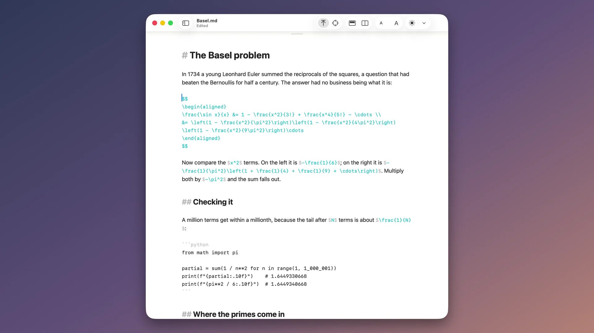
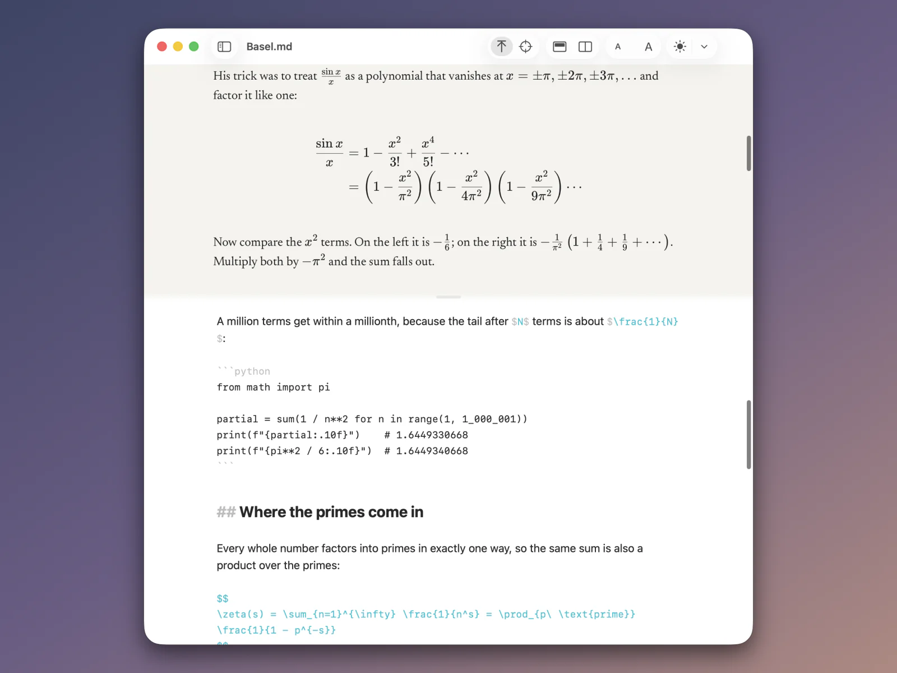
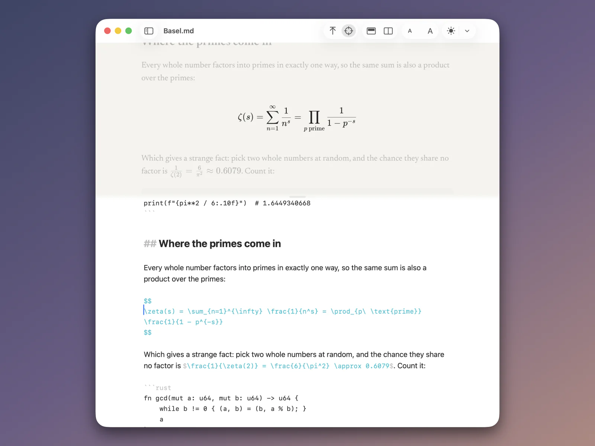
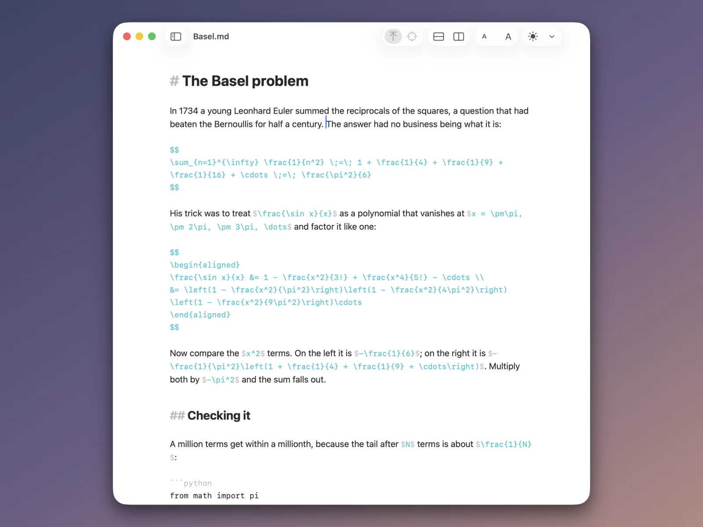
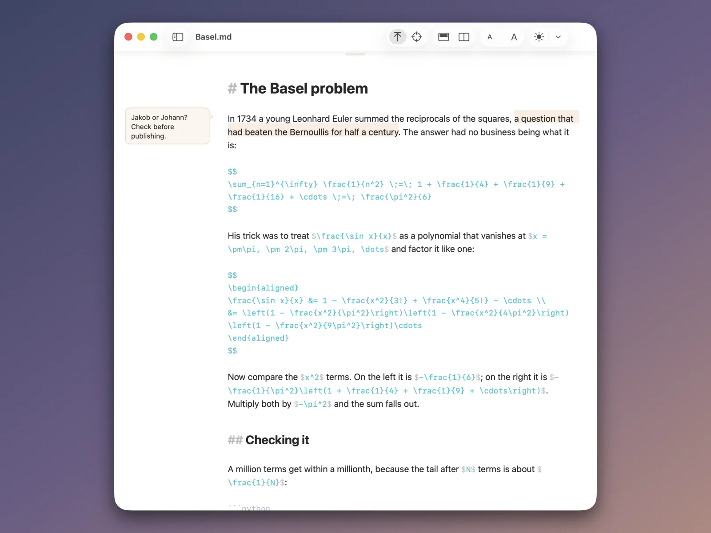
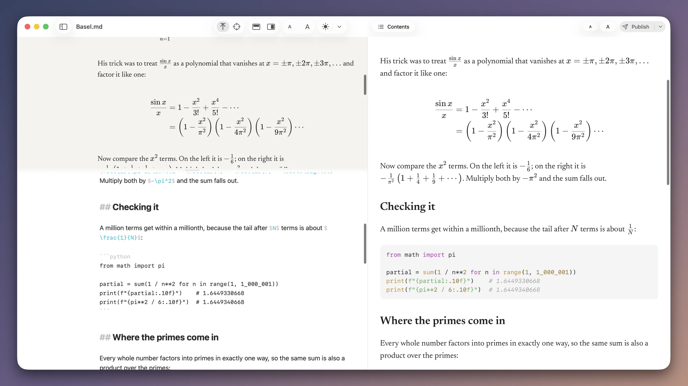
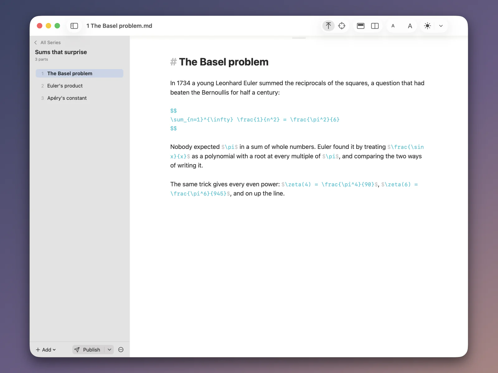
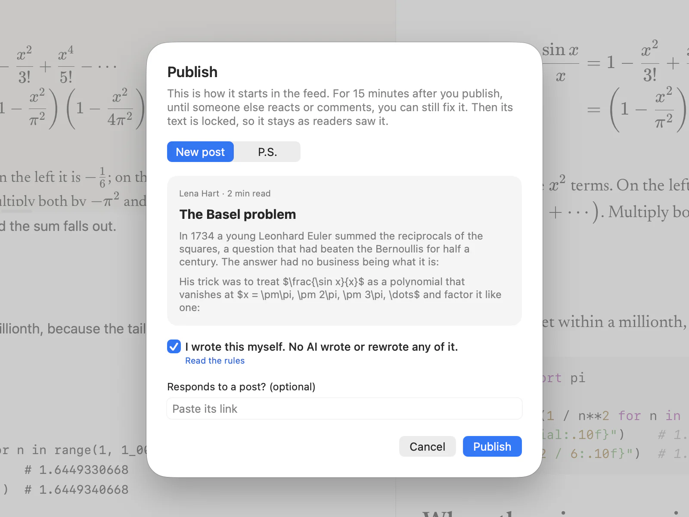
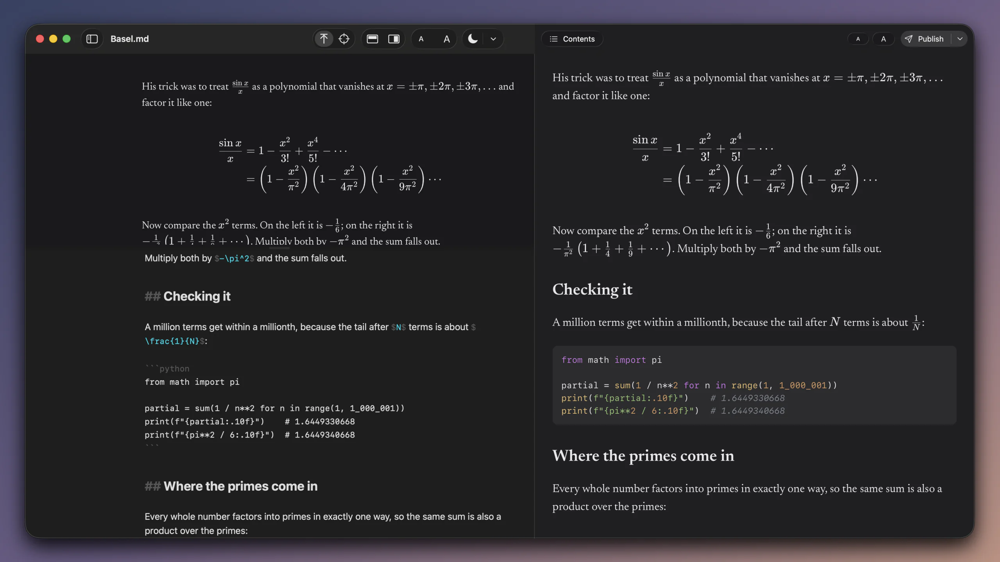

# Human Tokens

Writing by people, published at [human-tokens.dev](https://human-tokens.dev).
No AI wrote or rewrote any of it.

Posts are written and published from **Fold MD**, a quiet markdown editor built on the Fold pattern: your words set as you write them, in a sheet that folds down over the page. It's a Mac app, and it's [in the browser](https://human-tokens.dev/write) too, for posts.

[](https://human-tokens.dev/fold-md)

*▶ Fold MD in use, 46 seconds: [watch it on human-tokens.dev/fold-md](https://human-tokens.dev/fold-md).*

1. **Write in plain text.** Markdown, in a native Mac editor that stays out of your way. Your files stay on your Mac.
2. **See it as it will read.** A sheet folds down with your words set: math, code and images. The published page folds out beside you.
3. **Publish on your word.** When it's ready, publish from the editor and promise you wrote it yourself.

## What Fold MD does

**Scroll under the sheet.** What you've scrolled past slides under the sheet at the top and comes back set: maths, code and pictures as they'll read. Drag its edge down for more.



**Or just the paragraph you're on.** Switch the sheet to the current paragraph and it sets only what you're writing, as you type it. Good for a long formula or a table.



**Plain text, quietly coloured.** Close the sheet and it's just your words. Maths and code are coloured as you type them, and the spell checker leaves them alone.



**Notes to yourself.** Select a phrase and leave yourself a note in the margin. Notes stay on your Mac and are never published.



**The page, beside you.** The published page folds out to the right, as readers will see it, and keeps to where you're writing.



**Series.** Put documents in order as a series, without moving any files. It's published whole, each part a chapter.



**Published from the editor.** See how it starts in the feed, promise you wrote it yourself, and publish. For 15 minutes after, you can still fix it.



**Light or dark.** The writing, the sheet and the page all follow. Sun or moon, in the toolbar.



**Download Fold MD:** [Fold-MD.zip](https://github.com/tnspacetime/human-tokens-editor/releases/latest/download/Fold-MD.zip), for macOS 15 or later. Unzip it and move Fold MD into Applications.

It isn't signed by Apple yet, so the first time you open it macOS stops it. Open **System Settings ▸ Privacy & Security** and click **Open Anyway** beside the message about Fold MD; you do this once for each version. Fold MD tells you when there's a newer one ([releases](https://github.com/tnspacetime/human-tokens-editor/releases)). Or build it yourself in Xcode: [`apps/editor`](apps/editor#run-it).

## What's here

| Path | What |
| --- | --- |
| [`apps/editor`](apps/editor) | **Fold MD**, the macOS markdown editor posts are written and published from, built on the Fold pattern |
| [`apps/site`](apps/site) | **human-tokens.dev**: the feed, post pages, reactions and comments, sign-in (TanStack Start on Cloudflare Workers, D1, Better Auth) |
| [`packages/renderer`](packages/renderer) | Markdown → HTML (markdown-it, KaTeX, highlight.js), used by both, so a post looks the same in the editor and on the site |

The JavaScript parts are one [Bun](https://bun.sh) workspace: run `bun install` once at the root.

## Run the site locally

```bash
bun install
cd apps/site
bun run db:reset   # create the local D1 database and load the sample posts
bun run dev        # http://localhost:3100
```

`bun run dev` never touches the live site: its database and stored pictures are local copies (in `apps/site/.wrangler`).
`db:reset` also signs everyone out.

Every page tells search engines and link previews (iMessage, Slack, X…) its title, a line about it and its one address (`src/lib/share.ts`), with one share picture for the whole site.
The icons and that picture (`public/og.png`) are made from `brand/icon.html` and `brand/card.html` by `sh brand/make.sh` (it uses Google Chrome on your Mac); `public/favicon.svg` is written by hand.

Feed readers get the newest posts, whole (with their P.S.es), at `/rss.xml`, and one author's at `/@<handle>/rss.xml`; every page links the site's feed, and an author's page links theirs.
Search engines get every post, author and archive year at `/sitemap.xml`, which `robots.txt` names (`src/server/discovery.server.ts`).

### Kept safe

- **Security headers** (`src/start.ts`): every response says `nosniff`, `Referrer-Policy: strict-origin-when-cross-origin` and `X-Frame-Options: DENY`, and every page has a Content-Security-Policy.
  In a production build a page runs only its own scripts, each stamped with a fresh nonce; `bun run dev` relaxes that for Vite's reloading.
  Pictures may come from any `https` address (avatars, older posts), and inline styles are allowed because maths (KaTeX) uses them.
- **Rate limits** (`src/server/limits.server.ts`, `ratelimits` in `wrangler.jsonc`): asking for a code to connect Fold MD (10 a minute per address), Fold MD's preview (20 a minute per person), checking and uploading pictures (120), choosing how a post read (60), and comments and author notes (20).
  A person never gets near them; past one, the site answers "That's a lot in one minute. Wait a moment, then try again."
- **Hourly cleanup** (`src/server/cleanup.server.ts`, run from `src/server.ts` by the cron in `wrangler.jsonc`): removes sign-ins and Fold MD connect codes that have expired, and pictures uploaded but never published after a day.
  To run it locally while `bun run dev` is up: `curl "http://localhost:3100/cdn-cgi/handler/scheduled?cron=0+*+*+*+*"`.

### Sign-in

Anyone can read. To say how a post read or to comment, you sign in with Google or GitHub, from your account in the island at the top.
If you write as an author, you get the author's tools (a note under a comment) on your own posts.
Sign-in runs on [Better Auth](https://better-auth.com) with its tables in D1 (`migrations/0004_accounts.sql`).

Until the OAuth apps exist, `bun run dev` offers a **Dev** sign-in (dashed, at `/auth/dev`): sign in as a reader by name, or as one of the sample authors.
It is only in `vite dev` and only on localhost; a production build doesn't contain it.

To turn on Google and GitHub, copy `apps/site/.dev.vars.example` to `apps/site/.dev.vars` (gitignored) and fill it in:

1. **Secret.** Set `BETTER_AUTH_SECRET` to the output of `openssl rand -base64 32`.
2. **Google.** In the [Google Cloud console](https://console.cloud.google.com/apis/credentials), create a project, set up the OAuth consent screen (External; add yourself as a test user while it's in Testing), then *Create credentials → OAuth client ID → Web application*.
   - Authorized JavaScript origin: `http://localhost:3100`
   - Authorized redirect URI: `http://localhost:3100/api/auth/callback/google`
   - Put the client ID and secret in `GOOGLE_CLIENT_ID` and `GOOGLE_CLIENT_SECRET`.
3. **GitHub.** In *GitHub → Settings → Developer settings → [OAuth Apps](https://github.com/settings/developers) → New OAuth App*:
   - Homepage URL: `http://localhost:3100`
   - Authorization callback URL: `http://localhost:3100/api/auth/callback/github`
   - Generate a client secret, and put both in `GITHUB_CLIENT_ID` and `GITHUB_CLIENT_SECRET`.
4. Restart `bun run dev`. The island's account panel now offers Google and GitHub.

The live site has its own GitHub OAuth app, with the callback `https://human-tokens.dev/api/auth/callback/github`; the Google client lists both redirect URIs (`http://localhost:3100/…` and `https://human-tokens.dev/api/auth/callback/google`).
Signing in with Google and GitHub under the same verified email leads to the same person.

A real account becomes an author the first time it publishes from Fold MD (below).
To link yourself to a sample author locally instead, use the Dev sign-in "as an author".

## Publishing from Fold MD

Posts are published from Fold MD, never written on the site.
Open the publishing surface (⌥⌘P); its strip of the toolbar has a **Publish** pill.

1. **Connect, the first time.** Fold MD shows a short code (like `KQ4M-7TXD`) and an *Open human-tokens.dev* button.
   The site's `/connect` page asks you to sign in with Google or GitHub if you aren't, shows the code, and asks *Let Fold MD publish as you?*
   Click **Allow**: Fold MD notices within seconds and keeps its token in your login Keychain (*Fold MD · human-tokens.dev*).
   Your password is only ever typed on Google's or GitHub's own page.
2. **Your first publish.** Choose your author name (filled in from your account) and a handle.
3. **Publish.** The sheet shows the title and opening lines as the feed will, and the pledge: *I wrote this myself. No AI wrote or rewrote any of it.* Publishing needs the pledge every time.
   If it looks like a post you've already published (the same title, or the same opening), the sheet says which, with a link, and publishes it as a new post only once you tick *Publish this as a new post anyway*. The site is what knows: it checks your posts.
4. **Published · View** opens the post on the site, where you have the author's tools.
   While the post can still be fixed, the pill also sits in the window's own toolbar when the publishing surface is closed.
5. **Fix, for a short while.** For 15 minutes after publishing, and only until someone else reacts or comments, you can still fix the post: change the file, or a picture it shows (or, for a series, save a part), and the pill reads **Fix**.
   After that its text is locked, so what readers reacted to stays what's there. The site enforces it (`423 Locked`).
   Then Fold MD lets go of the post: the file is just a file again, and the pill reads **Publish**. Your posts are on your author page.
6. **Respond to a post.** When you publish a new post, paste the link of the post it responds to where the sheet asks (*Copy Link* is in the pill's menu while the post can be fixed, or copy it from the site).
   One of your own posts makes it a **follow-up**: it says *Follows …* under its byline, and the earlier post, which stays as it was, points forward to it.
   Anyone else's makes it a **reply**: it says *In reply to … by …*, and the post it answers lists it under *Replies*, at its foot and in the reader island. Anyone can reply to any post, and every reply shows.
7. **Pictures.** Drag or paste a picture into a post: Fold MD copies it into an `images` folder beside the file and links it. A picture linked from another website goes up too: Fold MD fetches it as you publish, so it can't change once the post is locked, and that website never sees your readers. When you publish, Fold MD gets each picture ready on your Mac first: at most 2000 pixels on its long side, the right way up, photos as JPEG (iPhone HEIC included) and screenshots as PNG, written afresh so nothing else in the file goes along (not where it was taken, not the camera). Then it sends the ones the site doesn't have yet, and the button says how far it's got.
   A post can have up to 20 pictures, 5 MB each and 10 MB in all; SVGs can't go up yet. With pictures, the pledge adds that they're yours or you're free to share them (how they were made doesn't matter).
   On the site they're kept in Cloudflare R2 under the SHA-256 of their bytes and shown at `/img/<hash>`, so a picture is stored once however often it's used. Your file keeps its links as you wrote them. Pictures are locked with the text, and go when their post goes.
8. **Add a P.S.** Write it in a document (at most 150 words, words only), then in the publish sheet choose **P.S.** instead of *New post* and paste the link of the post it goes under (one of yours); *Add as a P.S. to One of Your Posts…* in the pill's menu opens it that way.
   It goes at the end of the post, dated, with the pledge. It's how you add a correction or a thought once the text is locked. A P.S. can't be changed or removed, and the same one can't go twice.

An author can publish at most 50 new posts in 30 days: plenty for writing every day, and a stop on anyone flooding the site. Fixes and P.S.es don't count; a deleted post still does. When you've reached it, the publish sheet says so, and when you can publish again.

Every author has a page listing their posts, newest first: `/@handle`. Click the name in a byline, or your own name in the island's account panel.
To delete a post, open it while signed in as its author: **Delete…** is at its foot (it takes the post's reactions, comments and P.S.es with it).
**Unpublish** in the pill's menu does the same from Fold MD while the post can be fixed, and *Disconnect* is there too.
On the site, **Fold MD** in the island's account panel lists the Macs Fold MD is connected on (by the Mac's name), each with **Disconnect**: for a Mac you don't use any more, or one you've lost.

Only the file's markdown is sent. Self-notes stay in their own hidden file and never leave your Mac.
While a post can be fixed, Fold MD remembers which file it came from in its own folder, `Application Support/Fold MD/published/`, so your folders hold only your markdown. It finds the file again after you rename or move it, and removes the record once the fix window closes.
A debug build of Fold MD publishes to `http://localhost:3100`; run the site first (`bun run dev` in `apps/site`).
A **series** is published whole, as one post: open it in the series sidebar (⌃⌘S) and use the **Publish** pill at its foot.
The parts are joined in the sidebar's order, each part a chapter (its `# Title` becomes the chapter's heading), and on the site a small island at the foot of the page shows the part you're in and opens the list of parts.
It then follows the same rules as any post: the fix window, P.S. and follow-ups.

How it works: Better Auth's [device authorization](https://www.better-auth.com/docs/plugins/device-authorization) (`client_id` `fold-md`) and `bearer` plugins, with the device codes in `migrations/0005_publishing.sql`.
Fold MD then calls `/api/fold/*` (`apps/site/src/routes/api.fold.$.ts`) with `Authorization: Bearer <token>`; that API ignores cookies, so no web page can publish in your name.
During the fix window a file sends the same id with every publish, so publishing it again (a fix) changes its post instead of making a second one.

## Deploy

The live site is the Worker `human-tokens-site` on Cloudflare, served at `human-tokens.dev` only (`apps/site/wrangler.jsonc`), with its own D1 database and R2 bucket.
Cloudflare sends `www.human-tokens.dev` and plain `http://` on to `https://human-tokens.dev`.

```bash
cd apps/site
bun run db:migrate:live   # only after adding a migration: applies it to the live database
bun run deploy            # builds, then uploads (always this, not `wrangler deploy` alone)
```

The live site's keys are kept by Cloudflare, not in a file: `BETTER_AUTH_SECRET`, `BETTER_AUTH_URL` (`https://human-tokens.dev`), `GOOGLE_CLIENT_ID`, `GOOGLE_CLIENT_SECRET`, `GITHUB_CLIENT_ID` and `GITHUB_CLIENT_SECRET`.
To change one: `npx wrangler secret put <NAME>` in `apps/site`, then paste the value.

## Run the editor

See [`apps/editor`](apps/editor).

## Licence

[MIT](LICENSE): use, copy and change any of it freely, keeping the licence notice.
