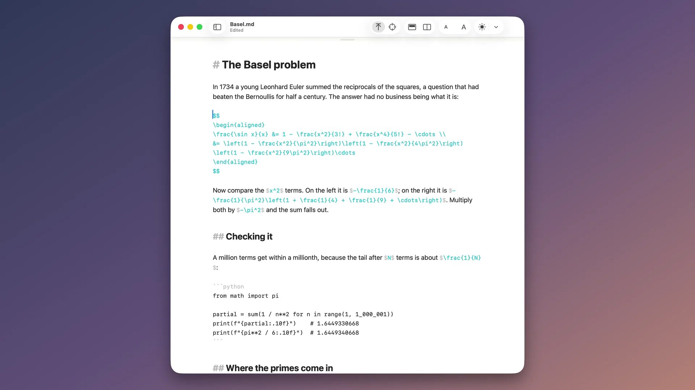
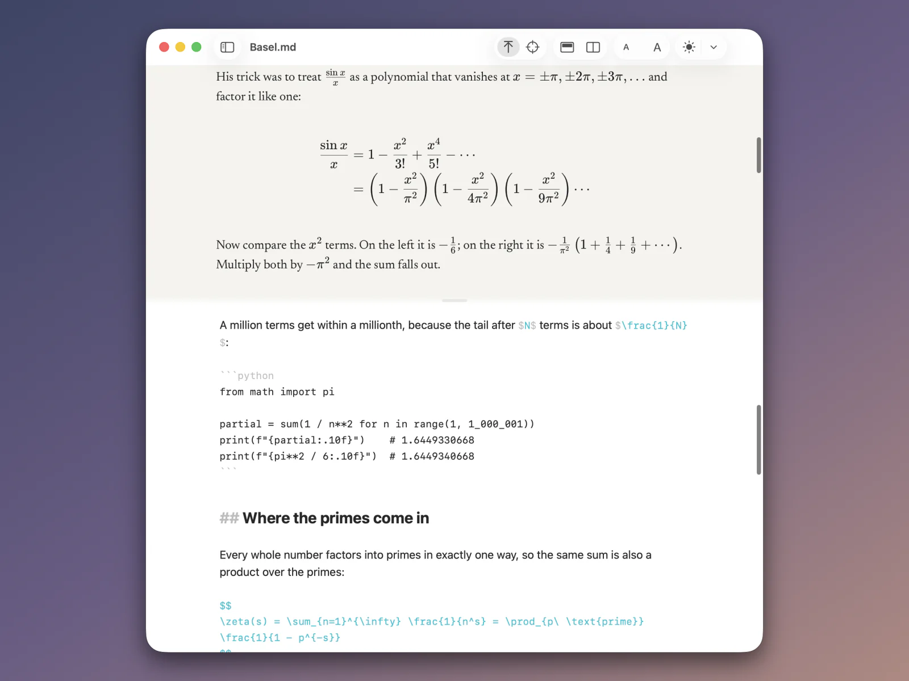
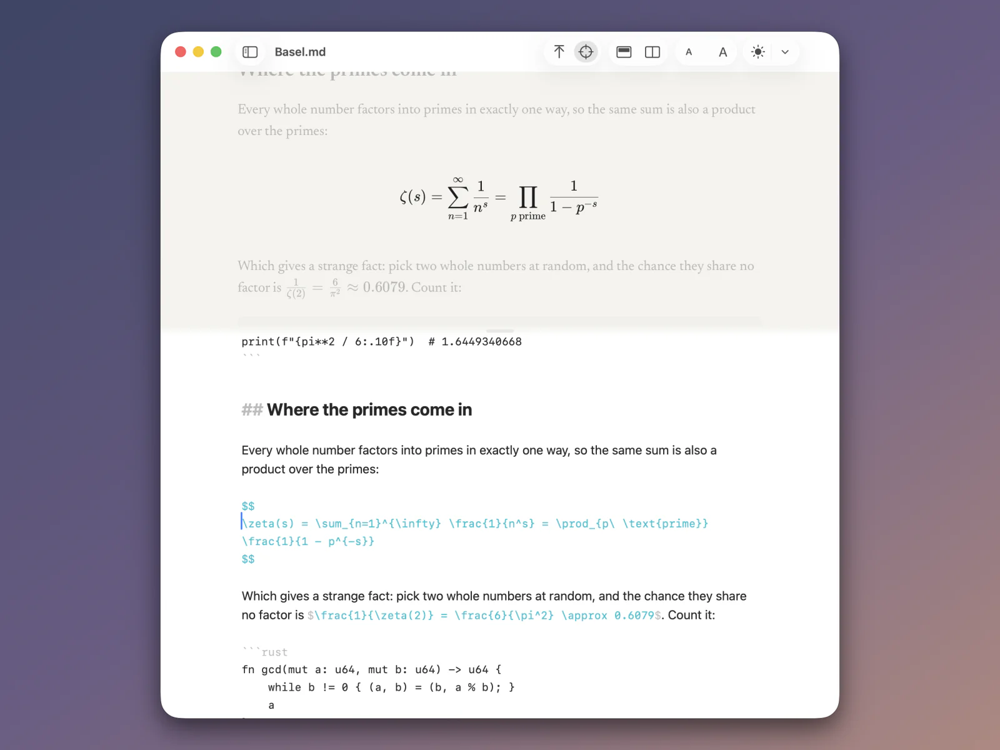
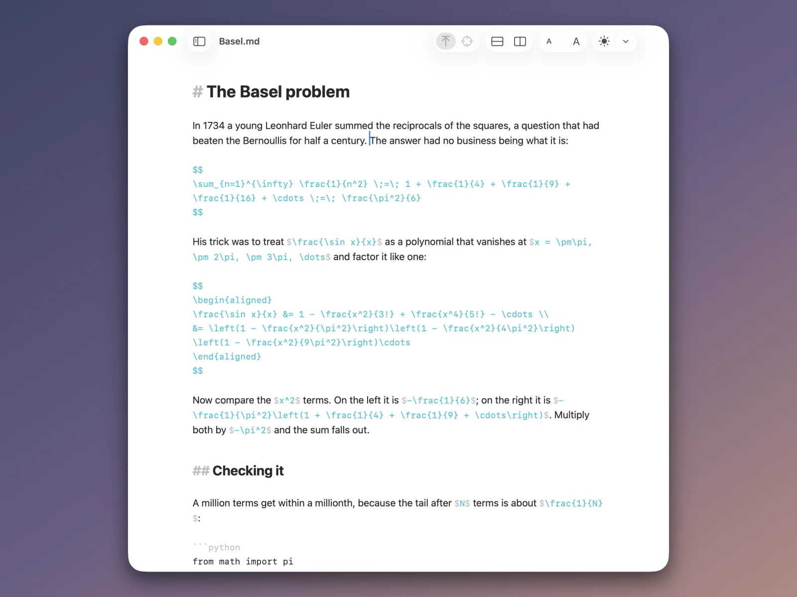
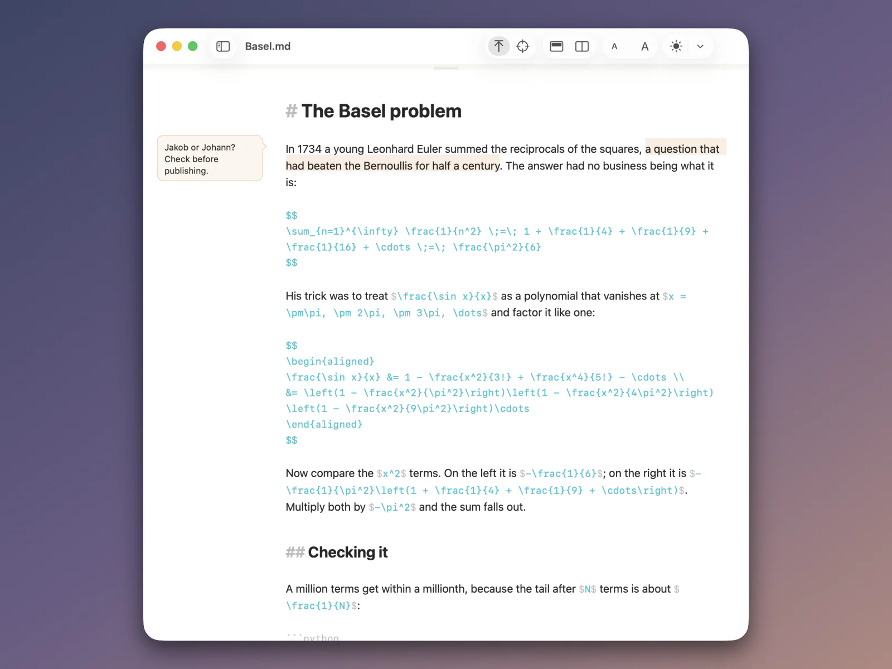
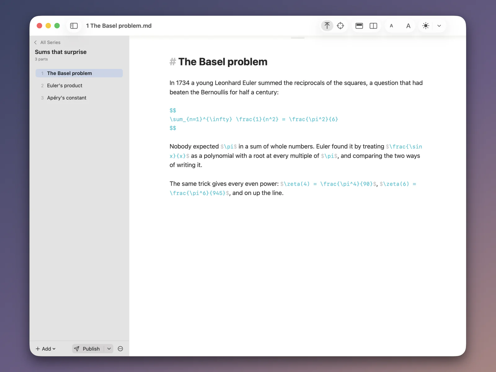
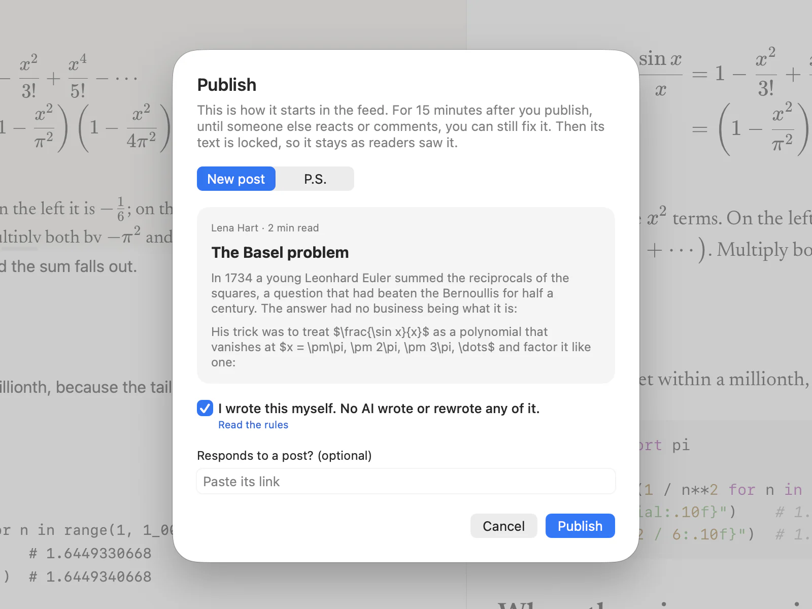
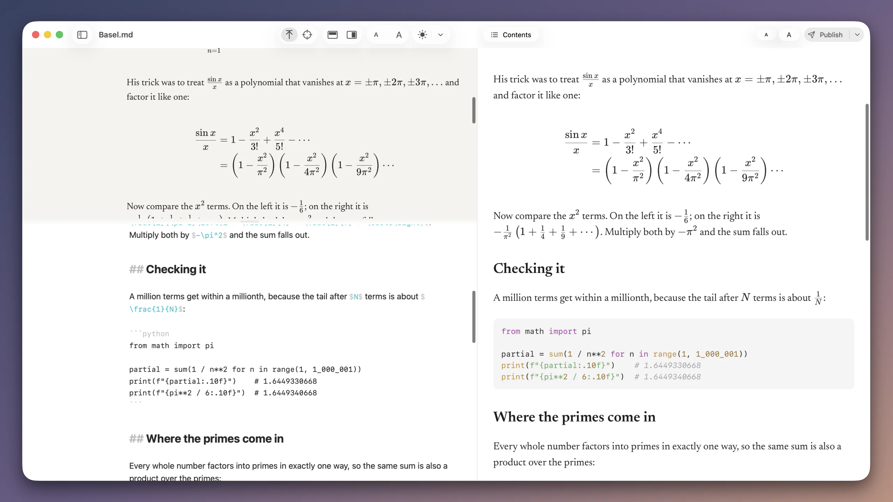
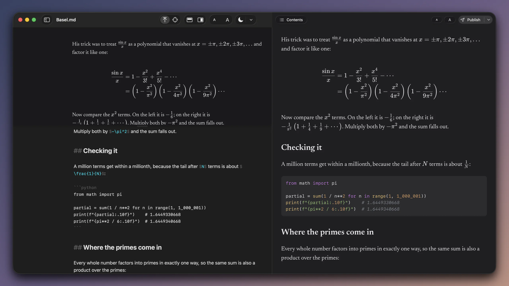

# Fold<sup>md</sup>

A minimal markdown editor for macOS, built on the Fold pattern. You write in plain, native source text.
A sheet folds down from the top to show it rendered, and the publishing
surface folds out to the right to show the page as it will be published.

- **Scroll under**: text you scroll past slides under the sheet and appears there rendered. Drag the sheet's handle down for more, or all the way for a full preview. While you type, the paragraph you're writing stays just below the sheet (typewriter scrolling).
- **Current paragraph**: the sheet renders the block your cursor is in (good for math, tables and code).
- **Publishing surface**: the window grows to the right and the published page slides out beside your writing, then slides back in.

Files are plain `.md` on disk. Series organise them without moving them, and images you drop or paste are copied into an `images` folder beside the document. The **Publish** pill in the publishing surface's toolbar strip publishes the document to [human-tokens.dev](../site): see *Publishing from Fold MD* in the [root README](../../README.md).

## What it does

[](../site/public/video/fold-md.h264.mp4)

*The demo above (46 seconds) is `apps/site/public/video`, recorded by `design/demo/record.sh`. It plays on the site's Write page.*

| | |
| --- | --- |
|  | **Scroll under the sheet.** What you've scrolled past slides under the sheet at the top and comes back set: maths, code and pictures as they'll read. Drag its edge down for more. |
|  | **Or just the paragraph you're on.** Switch the sheet to the current paragraph and it sets only what you're writing, as you type it. |
|  | **Plain text, quietly coloured.** Close the sheet and it's just your words. Maths and code are coloured as you type them, and the spell checker leaves them alone. |
|  | **Notes to yourself.** Select a phrase and leave yourself a note in the margin. Notes stay on your Mac and are never published. |
|  | **Series.** Put documents in order as a series, without moving any files. It's published whole, each part a chapter. |
|  | **Published from the editor.** See how it starts in the feed, promise you wrote it yourself, and publish. For 15 minutes after, you can still fix it. |

**The page, beside you.** The published page folds out to the right, as readers will see it, and keeps to where you're writing.



**Light or dark.** The writing, the sheet and the page all follow.



The screenshots are taken from a debug build by `design/shots/shoot.sh` (it sets each one up through the app's own test hooks, and puts your settings back after) and sized for the web by `design/shots/make-web.sh`.

## Run it

Open `apps/editor/FoldMD.xcodeproj` in Xcode and press ⌘R, or from the repository root:

```bash
xcodebuild -project apps/editor/FoldMD.xcodeproj -scheme FoldMD -derivedDataPath build/DerivedData build
open "build/DerivedData/Build/Products/Debug/Fold MD.app" apps/editor/docs/Welcome.md
```

| Action | How |
| --- | --- |
| New / open / save | ⌘N / ⌘O / ⌘S (autosave and versions are on) |
| Open by dragging | Drop a `.md` file on the window or the Dock icon |
| Show/hide sheet | ⌘\ or the toolbar button |
| Switch sheet mode | Toolbar segmented control |
| Publishing surface | ⌥⌘P or the toolbar button |
| Light / dark | Toolbar sun/moon (hold for System), ⇧⌘L, or View ▸ Appearance |
| Typewriter scrolling | View ▸ Typewriter Scrolling (⌥⌘T) |
| Jump to source | Click a rendered block in the sheet or the page |

## How it fits together

```
SwiftUI window (EditorWindow)
 ├─ writing surface
 │   ├─ sheet: PreviewView ─ WKWebView ─ renderer.html  (markdown-it + KaTeX + highlight.js)
 │   ├─ SheetHandle (drag to resize)
 │   └─ SourceEditor ─ FoldTextView (NSTextView, TextKit 1) + MarkdownHighlighter
 └─ publishing surface: PageSurface ─ WKWebView ─ renderer.html (page mode)
PreviewBridge (one per preview): Swift → JS calls (setDocument, scrollToLine, focusLine, setMode, setAnchor)
                                 JS → Swift messages (jump to a block's source line)
```

Swift owns the text and the files. The web views only render. The renderer
splits the document into top-level blocks and tags each one with the source
lines it came from, which is how the editor's scroll position and cursor line
map onto the sheet and the page.

| Path | What |
| --- | --- |
| `FoldMD/` | The app (an Xcode synchronized folder: new files are picked up automatically) |
| `web/` | The preview page (scroll sync, sheet modes, series). Markdown → HTML itself is [`packages/renderer`](../../packages/renderer), shared with the site. `bun install` at the repository root, then `bun run --cwd apps/editor/web build`, regenerates `FoldMD/renderer.html` |
| `design/` | Icon source: `swift design/icon.swift` redraws `FoldMD/Assets.xcassets/AppIcon.appiconset`. `design/demo` records the demo video, `design/shots` takes the screenshots |
| `docs/Welcome.md` | Sample document covering every feature |

`FoldMD/renderer.html` is generated but committed, so building the app doesn't need Node.

## Licenses of dependencies

All MIT, BSD or similar: markdown-it (MIT), KaTeX (MIT), highlight.js (BSD-3-Clause), esbuild (MIT, build only).
